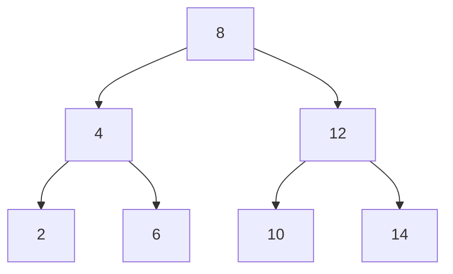

# BinaryTreeWithQt

> 基于 Qt Widgets 的二叉搜索树（BST）可视化练习：输入整数后插入节点，并用 QPainter 绘制节点与连线。

## 插入示例

按 `8, 4, 12, 2, 6, 10, 14` 的顺序插入，可得到以下 BST：



> 这是按源码插入规则绘制的示意图，不是应用运行截图；仓库目前没有界面截图。

## 功能

- 输入整数并点击 **添加节点**：较小值进入左子树，较大值进入右子树；重复值会被忽略。
- 使用 Qt `QPainter` 递归绘制树节点和父子连线。
- 提供 **删除节点** 和 **遍历树** 按钮；当前实现存在下文所列限制。

## 构建与运行

### 环境要求

- Qt Creator 与包含 **Qt Widgets** 的 Desktop Kit。
- 与所选 Qt Kit 匹配的 qmake 和 C++11 编译器（MinGW 或 MSVC）。

### 使用 Qt Creator

1. 打开 `BinaryTree.pro`。
2. 选择并配置已安装的 Desktop Kit。
3. 构建项目并运行。

### 使用 MinGW 命令行

在已配置 Qt/MinGW 的命令行中，从仓库根目录执行：

```bat
mkdir build
cd build
qmake ..\BinaryTree.pro
mingw32-make
```

使用 MSVC Kit 时，在对应的 Qt/MSVC 开发者命令行中运行 qmake，并以 `nmake` 替换 `mingw32-make`。

## 当前限制

- **遍历按钮尚未接通遍历输出：** 当前按钮槽只写调试日志；`Node::preOrderTraversal()` 输出到调试流，不显示在应用界面。
- **删除功能不完整：** 删除根节点时只修改按值传入的局部指针，主窗口根指针不会更新；删除叶节点会把空子节点传给 `addNode(Node*)`，删除不存在的值也可能沿空子节点继续递归并解引用。不要依赖它处理这些情况。
- 树形布局按窗口宽度和层级计算固定大小节点；树过深或窗口过窄时可能拥挤或越界。
- 仓库没有自动化测试目标或预编译发布包。
